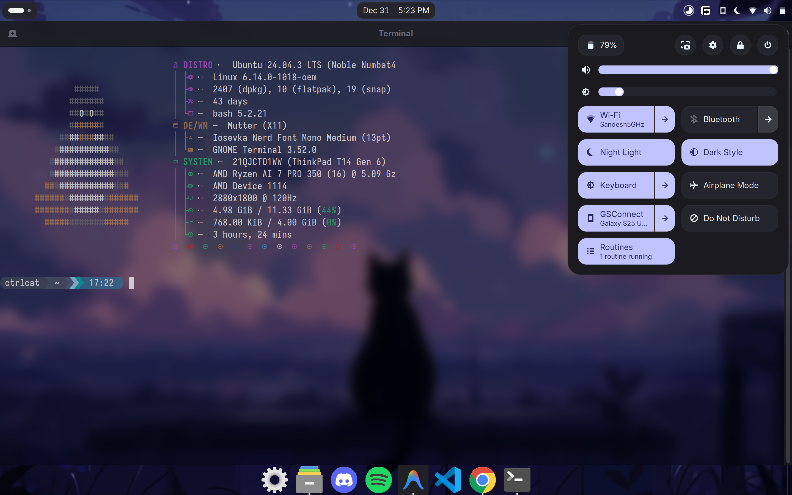

# MeowterialYou

Native **GNOME Shell Extension** (GNOME `45`–`50`) bringing live Material You dynamic theming from your wallpaper to GNOME Shell, GTK3/GTK4, icons, cursors, terminals, editors, notes, and desktop widgets.



> Looking for the older Python CLI version? Check out the [`legacy-python`](https://github.com/supSugam/MeowterialYou/tree/legacy-python) branch.

---

## Install & Update

No repo cloning, Node toolchain, or manual installer scripts required. Run one command to install the latest release bundle or update an existing installation:

```bash
curl -fsSL https://raw.githubusercontent.com/supSugam/MeowterialYou/main/scripts/install.sh | bash
```

### Specific Version or Uninstall

```bash
# Install a specific release tag
curl -fsSL https://raw.githubusercontent.com/supSugam/MeowterialYou/main/scripts/install.sh | bash -s -- --version v1.0.0

# Disable and uninstall completely
curl -fsSL https://raw.githubusercontent.com/supSugam/MeowterialYou/main/scripts/install.sh | bash -s -- --uninstall
```

### Manual Zip Install

Download `meowterialyou@supsugam.github.com.shell-extension.zip` from the [GitHub Releases](https://github.com/supSugam/MeowterialYou/releases/latest) page and install it directly:

```bash
gnome-extensions install --force meowterialyou@supsugam.github.com.shell-extension.zip
gnome-extensions enable meowterialyou@supsugam.github.com
```

> [!NOTE]
> On **Wayland**, log out and log back in once after installing or updating so GNOME Shell loads the new extension runtime. On **X11**, you can reload GNOME Shell with `Alt+F2` → `r`.

---

## Requirements

- **Required:** GNOME Shell `45`–`50`, `gnome-extensions` CLI (`gnome-shell`)
- **Optional (for specific features):**
  - `cava` — required only for the **Desktop Audio Visualizer** widget
  - `python3` + `python3-numpy` — required only for **Use MeowterialYou Cursor** Xcursor repacking
  - `fastfetch` — required only for **Fastfetch** theming & per-launch logo cycling
  - **User Themes** extension — recommended if theming GNOME Shell chrome (`~/.local/share/themes/MeowterialYou-*`)

---

## Features & Preferences

Open settings via the **top bar indicator** → **Preferences**, or run:

```bash
gnome-extensions prefs meowterialyou@supsugam.github.com
```

### General & Shell Theming
- Live color extraction directly from your current dark or light wallpaper via `@material/material-color-utilities`
- **9 Material You Scheme Variants:** `Tonal Spot`, `Neutral`, `Vibrant`, `Expressive`, `Rainbow`, `Fruit Salad`, `Content`, `Monochrome`, `Fidelity`
- Synchronizes GNOME **dark/light** mode with system appearance (`color-scheme`), **GTK3**, **GTK4 / Libadwaita**, GNOME Shell popups, Quick Settings, Overview, and **Blur My Shell** popup styling
- Optional **Transparent Top Bar** and top panel indicator with quick dark/light switch and force reapply
- Automatic backup and clean restoration of your original GTK, Shell, Icon, Cursor, and window button settings when disabled

### Appearance (Window Controls, Icons & Cursors)
- **Window Controls:** Native or **macOS-style** circular buttons positioned on the left or right
- **Folder Icons (`Meowaita`):** Dynamically recolors 34 folder/place SVGs to match your wallpaper accent, ships 235 bundled app icons, and falls back to your chosen base icon pack
- **Use MeowterialYou Cursor:** Asynchronously repacks your selected Xcursor theme (e.g. `Bibata-Modern-Classic`, `Adwaita`, `Yaru`) into `~/.local/share/icons/MeowterialYou-Cursor` preserving all sizes, animations, and hotspots, with 3 color styles (`Tinted Fill + Crisp Outline`, `Vibrant Accent Fill`, `Dark Body + Accent Outline`)

### Wallpaper Cycler
- Rotate wallpapers automatically from a chosen folder at a configurable interval (minutes)
- Cycle order: `Random`, `Alphabetical`, or `Date Modified`

### App Integrations (`Apps` Tab)
- **GNOME Terminal & GNOME Console:** Live palette theming
- **Ghostty:** Dynamic theme generation with automatic light/dark switching (`window-theme = ghostty`)
- **Shell Prompt & Colors (Bash/Zsh):** Auto-reloading `~/.config/meowterialyou/prompt.sh` with ANSI `PS1`, git branch status, `LS_COLORS`, `GCC_COLORS`, and `GREP_COLORS`
- **VS Code, Forks & Antigravity:** Generates and updates Material You Light & Dark themes
- **Obsidian:** Generates full `theme.css` palettes across discovered Obsidian vaults
- **Fastfetch:** Material You colors in `~/.config/fastfetch/config.jsonc`, optional 3-section layout preset, aspect-calibrated logo sizing, and **per-launch logo rotation** across a selected logo folder

### Widgets (`Widgets` Tab)
- **Desktop Audio Visualizer:** Live CAVA spectrum layered above your wallpaper and behind all windows (`Bottom`, `Top`, `Left`, or `Right`)
- Styles: `Bars`, `Mirrored`, `Wave` (smooth Bezier fill)
- Color modes: `Base to Tip`, `Across Spectrum`, `Solid Accent`
- Per-pixel customization: **Base Padding**, **Side Padding**, **Size**, **Bar Count**, **Bar Spacing**, **Corner Radius** (`0%` sharp → `100%` capsule), **Opacity**, fades cleanly on silence, and pauses automatically in fullscreen

### Tweaks (`Tweaks` Tab)
- Top bar visibility toggles (Workspace Indicator, Accessibility Menu, Keyboard Layout, Clock Notification Dot)
- Configurable tray indicator gap spacing
- **Type to Search** in Overview and optional hiding of overview window close buttons

---

## Screenshots

| Dark Shell | Light Shell |
| :---: | :---: |
|  |  |

| Obsidian Dark | VS Code Dark |
| :---: | :---: |
|  |  |

---

## Development & Releasing

Requirements: Node.js `20+`, `pnpm`, `glib-compile-schemas` (`libglib2.0-dev-bin`), `gnome-extensions`.

```bash
pnpm install
make typecheck
make install       # compiles schemas, bundles dist/, symlinks to ~/.local/share/gnome-shell/extensions/
make prefs         # opens extension preferences
make pack          # builds dist/ and outputs meowterialyou@supsugam.github.com.shell-extension.zip
```

### Cutting a Release

Tag pushes (`v*`) trigger [`.github/workflows/release.yml`](.github/workflows/release.yml) to typecheck, build, package `meowterialyou@supsugam.github.com.shell-extension.zip` (with SHA256), and publish a GitHub Release automatically:

```bash
./scripts/release.sh patch --push   # bumps package.json SemVer + metadata.json version integer, commits, tags, and pushes
```

---

## Contributing & Credits

Bug reports and feature ideas are welcome via [GitHub Issues](https://github.com/supSugam/MeowterialYou/issues).

- [Google Material Color Utilities](https://github.com/material-foundation/material-color-utilities)
- [Mitsugen](https://github.com/DimitrisMilonopoulos/mitsugen) (inspiration for the original legacy Python tool)
- GNOME Shell, GTK4 & Libadwaita
